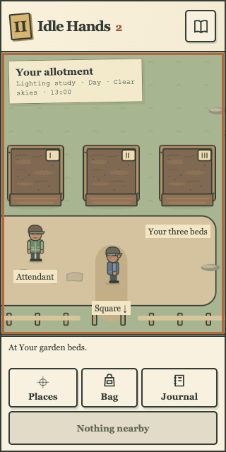
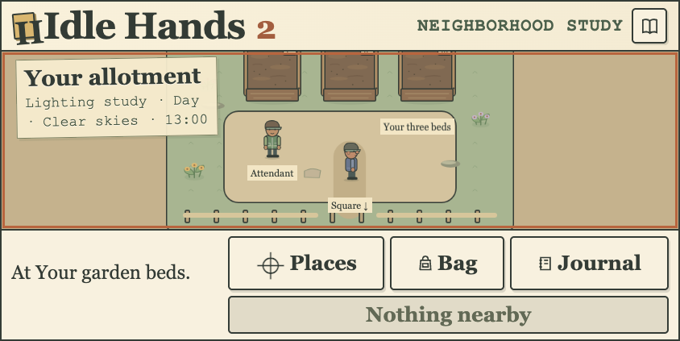

# Stable action bar — locally verified, source release held

The contextual action now reserves the intrinsic space of its longest current label, “Enter workshop”, using its actual font and button padding. The displayed wording, accessible name, disabled state and actions stay unchanged. A presentational text span shares the hidden sizing layer’s grid cell; it inherits the button font rather than the unrelated navigation-icon font. No new control or gameplay state is introduced.

Long field notes keep their existing readable, keyboard-scrollable reserved region. A deterministic flex basis prevents long status text from taking space from the controls. At doubled text in a short landscape viewport, deliberate vertical page scrolling preserves a minimum 220 CSS-pixel playfield and reachable full-size controls. No text shrinking, whole-word splitting or horizontal page overflow is accepted.

The inherited320×640 native Inspect→Nothing nearby path shrank the world by53CSSpixels and moved navigation controls. The new regression fails on that old layout. Three focused cases now cover nine shapes:1440desktop,900medium,320/360/390phones,844×390short and320/360/short doubled text. They move natively through Inspect/entry/none, compare all four control rectangles and world height/zoom, tap original button coordinates after the context changes, exercise keyboard menus/focus and read/scroll declared long feedback. Control positions use document coordinates, so intentional page scrolling is distinguished from actual reflow.

A separate actual frozen208-response build passes root native checks at five shapes and provides15captures. All202prior artwork files are byte-identical. All208actual HTTP responses match their frozen manifest. The candidate adds552raw/141per-file-gzip bytes over corrected097V2. System checks pass338with zero skips; strict build/design/plan/pinned pass. Final full132browser cases pass in959,428.16ms, with zero skipped, flaky, unexpected cases or report errors. Final build/design/53taskplan/10tracker/40pinned/diff checks pass. Discovery is disjoint67+65with the ordered shared family on shard2. Terra independently sampled fresh native desktop,320/360phones and short200; it found no usability blocker, confirmed stable400pxcanvas and at least44pxtargets, and recorded33pxof deliberate short200page scrolling. It did not independently exercise long feedback or physical devices.

Native evidence uses fresh isolated browser saves and real Journal routing/keyboard movement. Cosmetic day/clear/root-text settings are declared. The long-note regression supplies only an explicitly labelled UI text fixture; no stock, position, clock or API data is injected. No real player, original Idle Hands, server/domain/schema/protocol/dependency/workflow, protected accepted clients or paid/cloud system changes. Desktop Chrome phone emulation is not physical-device/Safari verification.

A first full run completed130passing cases and two failures at the old short200assumption that every button must be on screen before scrolling (actual bottoms414/415versus390). Both affected tests now retain the same44pxsizes, horizontal bounds and actual viewport-bottom assertions after scrolling each target into view; a nonnegative top assertion is added. Immediate fit remains strict at other sizes. All gameplay/authority/timer/assertions and timeouts are unchanged. The focused old town-variety journey passes with the new deliberate reachability behavior; the entire final132suite now passes. Failed-run artifacts and its teardown errors are retained separately rather than reported as a pass.

A second review address, http://toolbar-town.localhost:49579/?town=1, serves the same208frozen responses against a separate49580process using34byte-identical accepted090API5/game/migration/tool source files. Startup reads and validates only the existing guarded ih2_menu_review namespace:26fictionalprofiles/25historically earned homes/3selectable roles; no initializer/reset/migration is present. A new in-memory key leaves older review and protected keys/processes intact. Native host-only synthetic canaries prove that127.0.0.1/localhostsessions are not sent to the review host, an actual signed review snapshot authenticates, and an unapproved127.0.0.1frontend origin is denied403. No real cookie/key values are recorded. Native desktop/320/short200shared garden movement preserves material/items/placements/kits/jobs and stable control geometry. Those moves are real API actions in the fictional population, not intercepted replies or real-player progress. Historical population and cosmetic settings remain disclosed fixtures.

Normal exact-final-head GitHub checks, uploaded artifact inspection and accepted-client/preservation gates remain required. The previous PR39run was refused before tests for account billing/spending-limit status; this local candidate does not bypass it or update accepted090.

Final preservation checks confirm all fields of13tables per protected/Tour namespace, private-key hashes/mode0600, six migration checksums and all54acceptedstudy responses unchanged. The regular090clients and matched API5remain intact. No additional per-frame JavaScript, gameplay action or network calculation was added by this presentation fix. No performance improvement is asserted from these checks.

Selected craft/Pine images come from real fresh local journeys and real first5secondcraft; no stock/time/reply fixture is used for those paths. The trail screenshot comes from the full suite’s explicitly isolated ih2_browser chapter: UI-earned funding/house, then a sole SQL fixture moves both bridge timestamps6hearlier while preserving duration. It is not a real6hwait. Other full-suite cases include the existing declared elapsed snapshots/reply interception, documented in their test sources; they are not real-player or production verification.

Next independent099feasibility/design uses accepted090runtime, not an accepted promotion of this held stack. Its selected defaults must distinguish study assumptions from implemented rules, and it cannot introduce food/crops/timers/state into current gameplay.
