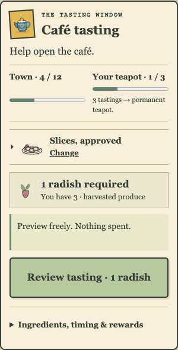
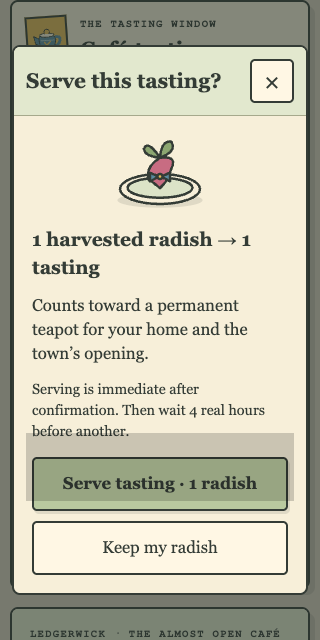
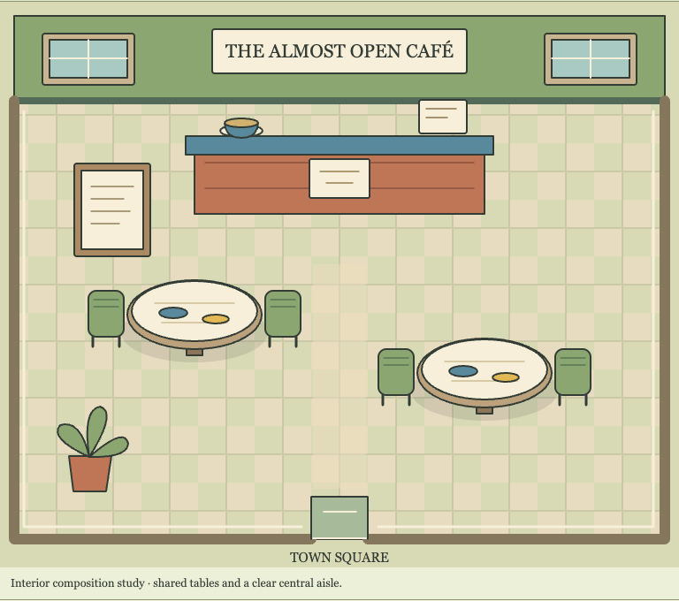

# Café study — locally verified, not implemented gameplay

The selected small direction is an optional tasting chapter using one harvested radish, immediate serving and a free presentation choice. It proposes a shared café opening and a permanent personal teapot, while keeping the ingredient decision clear. A short caption explains “3 tastings → permanent teapot”; confirmation names the cost and a last-radish conflict with Pip. Choices and longer notes open deliberately. This is a separate design, art and menu study, not a café/food/room/command added to the game.

The actual frozen V2 is available at http://cafe-review.localhost:49586/#counter. All13HTTPresponses match the manifest;6neworiginalSVGs and2acceptedreuses are unchanged between V1/V2. The study is47,631raw /16,976per-file-gzip bytes and adds zero runtime payload. V1 remains immutable at49584. Root captures actual native touch/mouse/keyboard, free cancellation/confirmation and graphic keyboard pan/reset at desktop,320/360phones and narrow/short doubled text. The final card has a single named primary action with cost/held/output context, without the first draft’s987pxlist. Fifteen frozenV2captures and bounded TerraV1scenario/V2caption reviews are retained. No sampled blocker remains. Graphic views are not actual Phaser rooms or collision/phone-camera proof.

Seven added analytical/art checks bring this independent090-based branch to329systemchecks, zero PostgreSQL skips (57,593.162375ms). All110browsercases pass (887,901.838ms) with zero skips/flakes/unexpected cases/reporterrors. Strictbuild/design,54taskplan/10trackerchecks,40pinnedfiles and whitespace pass. Discovery is disjoint55+55, with the ordered shared-town/starter-homes/trail/first-visit family on2. This branch preserves all322/108accepted090checks; the separate held098branch still retains its338/132suite. A future consolidation must retain both sets, not treat the differing branch baselines as removed coverage.

The source audit covers all48dated catalog entries:21boundedexistingdefinitions,3relatedslices,24futureonly. Null herb/food prices stay unchanged and no runtime IDs are aliased. The576analyticalvariants/24scenerycontrols conserve seeds, plants, produce, pine and bounded hypothetical queues. One/four-command-per-minute budgets expose uncalibrated time-cost sensitivity, not measured playtime or retention. A new2minpreparation queue adds waiting and a paid-result race without a new purpose, so the selected study has no queue or edible inventory. It is still a finite chapter and does not establish thirty-to-sixty-minute active content. Full design, exact defaults, scenarios and future authority gates are in [the design record](../../idle-hands-2/design/CAFE_HOSPITALITY_STUDY.md).

All204rebuilt090client and198art files match their pre-study baseline byte-for-byte. No src/server/public/package/lock/workflow file changes. Actual accepted090clients/API5, protected/Tourall13tablefields, privatekeyhashes/mode0600, six migration checksums per namespace and54acceptedstudy responses are preserved. Actual208responses from each098review origin and13from each caféV1/V2origin remain unchanged. No original Idle Hands, real identity, cloud/billing/hosting or expense change.

Every study stock/progress state is fictional. The400ms/5ssynthetic confirmation and900msstale-town example are UI demonstrations, not intercepted server results. Tests use isolated invalid game-key canaries to prove zero storage access; native study paths never call a game API. Existing broader regression tests retain their declared synthetic elapsed snapshots, held replies and SQL time fixtures; they are not real-player or production tests. Two sampled quote DOM axe scans have zero violations, with incomplete checks retained. Physical devices, Safari, full screen-reader/accessibility coverage, sustained performance and human enjoyment remain unverified.

Required normal exact-final-head GitHub checks/rawartifact/source/accepted-client gates remain unmet after the old PR39accountbillingrefusal. No redundant workflow run or PR, alternative runner, main merge or regular-preview replacement is used. The proposed café still needs versioned conservation/migration/protocol, real store/HTTP/proximity/UUID/retry and in-game tests before integration. Next independent100authors only a first Aster serving-gesture study, leaving the other three rigs unfinished until reviewed.

