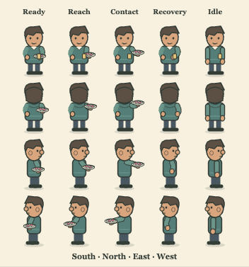
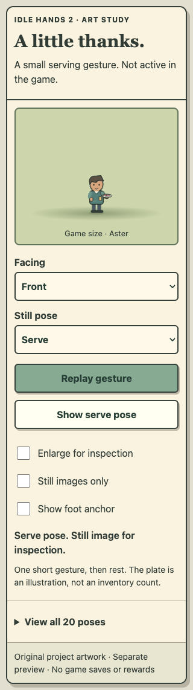
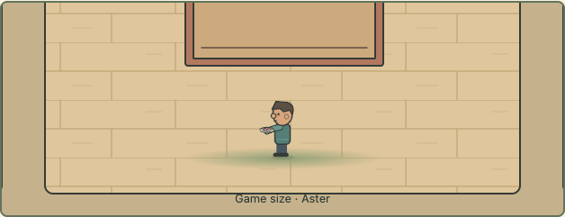

# First serving gesture — local candidate art

Aster now has a small, readable four-direction serving study with 20 poses and one bounded replay. A thin sleeve outline addresses Terra’s first profile-connection refinement; the second sampled review found the hand-to-plate connection clearer and no new blocker. The actual game, café, rewards and accepted preview are unchanged. Bea, Casey and Devon remain unfinished.

The frozen eight-file gallery is at http://serving-review.localhost:49590/ . Native Enter/Space buttons and standard selectOption facing choices, mouse and browser touch checks cover desktop, 320/360 phones, narrow doubled text and short doubled text. Labels remain whole, controls are at least 44 CSS pixels high, and the page scrolls deliberately. Static pose selection, direction changes, reduced-motion preference and cancellation were exercised. A real-clock native replay displayed columns 0,1,2,3,4 at approximately 0,165,342,520,721 ms. These timings are local scheduling observations, not a frame-rate or physical-device guarantee.

The raster check decodes every isolated frame with an eight-pixel expanded border. All 20 cells have zero alpha outside their actual 64×80 frame and identical y64–79 foot pixels to their same-facing accepted idle. The final idle body is exact original source. East/west vectors are exact reflections. Cross-transform antialias RGBA is retained as diagnostics; a mistaken exact-raster-mirror assertion was rejected after inspection, rather than confusing edge antialiasing with geometry drift. Mirrored bounds allow only one fringe pixel; crop and same-facing foot equality remain exact. Root inspected game-size and 2× views, the complete contact sheet, and eight declared composites over accepted grass/wood artwork. These composites are not Phaser-world integration.

The generator is safely guarded to output only this task’s evidence or an external isolated directory. It refuses public/runtime and unrelated repository paths before writing. Source/output hashes and original-rig provenance are retained. All eight actual frozen HTTP bodies match their manifest. The gallery is 117,952 raw bytes / 10,459 summed per-file gzip bytes; zero bytes are added to the playable client.

Final local checks pass:325system, zero PostgreSQL skips (55,887.162417ms), and110browser (863,270.129ms), zero skipped/flaky/unexpected cases or report errors. Strict build/design,55-taskplan/10trackerchecks,40pinnedfiles and whitespace pass. Discovery is disjoint58+52with the ordered family on2. After the full suite, only raw-artifact copy plumbing was added to browser afterAll; both focused cases reran successfully and the eight packaged study files match source exactly. The full report remains separately retained. Details are in local-checks.json. The original 322 system and 108 browser cases remain on this independent accepted090 runtime base, with three source/art checks and two browser cases added. Do not confuse this branch’s baseline with the additional held098 or099 branch-specific cases; future consolidation must retain all of them.

All 204 rebuilt accepted client files and 198 runtime art files are byte-identical. Actual HTTP checks also match all 204 files on each accepted preview, all 208 on each held098 review, and all 13 on each café V1/V2 gallery. Protected practice/Tour namespaces retain all 13 tables/all fields, private key hashes/mode0600 and six migration checksums each. All 54 accepted study responses are unchanged. No `src/`, `server/`, `public/`, package, lockfile or workflow change is included. Real players, the original game, cloud resources and billing are untouched.

Disclosures: this gallery has no game API or save access. Native review uses viewport/font/reduced-motion emulation; its contrast captures replace only a study background with exact original art. A browser cancellation test explicitly synthesizes document.hidden; it is not a real phone lifecycle test. Existing regression cases retain their declared isolated elapsed snapshots, held replies and synthetic SQL-time data. No real accounts/progress are used. A requested optional video capture could not start because the local Playwright video encoder is absent; real-clock pose observations and still screenshots were used, without installing a dependency. A separate native-OS select-popup keyboard attempt did not select as assumed in this headless Mac harness; it was retained as a harness limit and did not cause a game-control rewrite. Safari, physical phones, that native popup behavior, full accessibility/screen-reader coverage, actual Phaser action integration and human enjoyment remain unverified.

Normal exact-final-head GitHub jobs/raw uploaded artifact/source gates remain unmet after the prior PR39 account billing refusal. No redundant workflow/PR, alternate runner, main merge or accepted-preview replacement is used. Local verification does not constitute source acceptance or a public release.

