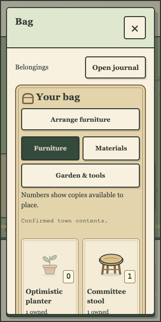
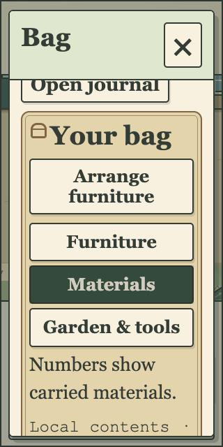

# Bag quantities that explain what is available

The Bag now explains its numbers before the item grid. Furniture says “Numbers show copies available to place”; Materials names carried materials; Garden & tools names kept items. Every badge's accessible name includes the actual item and its available-to-place/carried/kept meaning. Existing owned/placed details and unknown “?” counts remain unchanged. The previous flavor intro is repurposed and relocated, and the redundant bottom paragraph is shorter; this does not add another tutorial panel.

Terra's first review found the removed intro left the Bag icon touching the Arrange button on narrow phones. V2 restores a small12pxheading gap. Existing responsive checks now measure the actual pseudo-icon extent and require at least4pxseparation. Root's eight native desktop/phone/text shapes and24pocket captures measure8–12pxclear gaps, complete new words, one count-key node, correct accessible names and unchanged holdings. Actual fictional Lane shows an Optimistic planter with0available beside1owned/1placed. TerraV2also sampled settled keyboard focus beneath the sticky header and found no remaining blocker.

FrozenV2 local-only review: http://bag-review.localhost:49600/ . Dedicated fictional-town review: http://bag-town.localhost:49602/?town=1 . Both serve the same208file artifact;416actual body hashes match. All202runtime art files are unchanged. Relative to held098, V2adds233raw bytes /48summed-per-file gzip bytes. The separate review process uses byte-identical090API5source, existing guarded26fictional profiles/25historical homes, six existing migrations and a new in-memory signing key. No initializer/reset/migration or accepted key is used. Actual signed Lane snapshot200, isolated fake cookie canaries and rejected nonapproved frontend origin403 pass.

V1static49592is retained as a rejected spacing archive. Its first shared review inherited the wrong proxy Host setting and could not reach identity selection. Only those unused own V1frontend/API processes were stopped. V2corrects the review-only reverse proxy; the backend loopback Host guard and explicit allowed Origin remain unchanged. This is not a game-server security change or a replacement for an accepted service.

System338/zero PostgreSQL skips, strictbuild/design/plan/pinned/whitespace and focused5browser checks pass. Final full132case V2browser regression passes in960,607.407ms, zero skipped/flaky/unexpected cases or report errors. System338passes in55,868.897mswith zero PostgreSQL skips. Disjoint67+65shard discovery covers all132cases, with the ordered shared family only on2. Strict build/design,56-taskplan/10trackerchecks,40pinnedfiles and whitespace pass. See local-checks.json. The earlier fullV1run was intentionally interrupted after Terra's real spacing finding; its partial results are retained and do not count as a pass. Initial new assertions used abbreviated furniture names and were corrected to their existing canonical item names, without changing the game. All original inventory, allocation, claim/placement/reload, free-pocket, art-fallback and persistence assertions remain. A completed V2full run then exposed a garden-resize sampling race:131passed/1failed. Eight focused diagnostics across held098and101V2show the identical sequence: intermediate187pxcanvas before enlarged-text layout and camera settle at220px. The old zoom-only readiness could pass because both frames already used the0.75minimum zoom. A new read-only test predicate waits for actual text mode and DOM/canvas/camera dimensions to agree; all original minus-one crop bounds,44pxtargets, collision/progress assertions and timeouts remain unchanged. Both garden and five Bag cases pass in a focused7-case rerun. The fresh final full132run passes; earlier failure evidence remains retained and normal source acceptance gates remain required.

The root native harness also initially attempted keyboard activation before a shared panel's existing pending refresh settled. It now waits for that refresh and enabled controls, checks that the dialog remains open, and retains the same strict geometry threshold. No control was forced enabled and no game logic changed. Failed harness evidence is retained separately.

Accepted090clients/API/protected and Tour data/keys/checksums/54studies remain preserved. Actual earlier client/study HTTP bytes are exact, including held098and caféV1/V2/serving100. No inventory availability calculation, ownership, timer, economy, server, schema, asset, dependency or original-game change. Normal exact-final-head GitHub/rawuploadedartifact/source/accepted-preview gates remain unmet after the prior PR39billing refusal. No main merge or accepted-preview/public release.

Disclosures: native root/Terra review uses cosmetic day/clear and viewport/root-text emulation, existing fictional Lane data and fresh local defaults. It issues no craft/claim/placement command or stock/position/clock/reply override; holdings stay unchanged. Existing broader browser tests retain their declared isolated elapsed snapshots, intercepted allocation/reply/art failures and synthetic SQL-time fixtures. Two scoped Bag DOM axe scans at desktop and320/root200found zero violations and zero incomplete checks; they do not certify the surrounding game or full accessibility. Physical phones, Safari, full screen-reader/accessibility and human enjoyment remain unverified. Full local checks are distinct from source acceptance.

